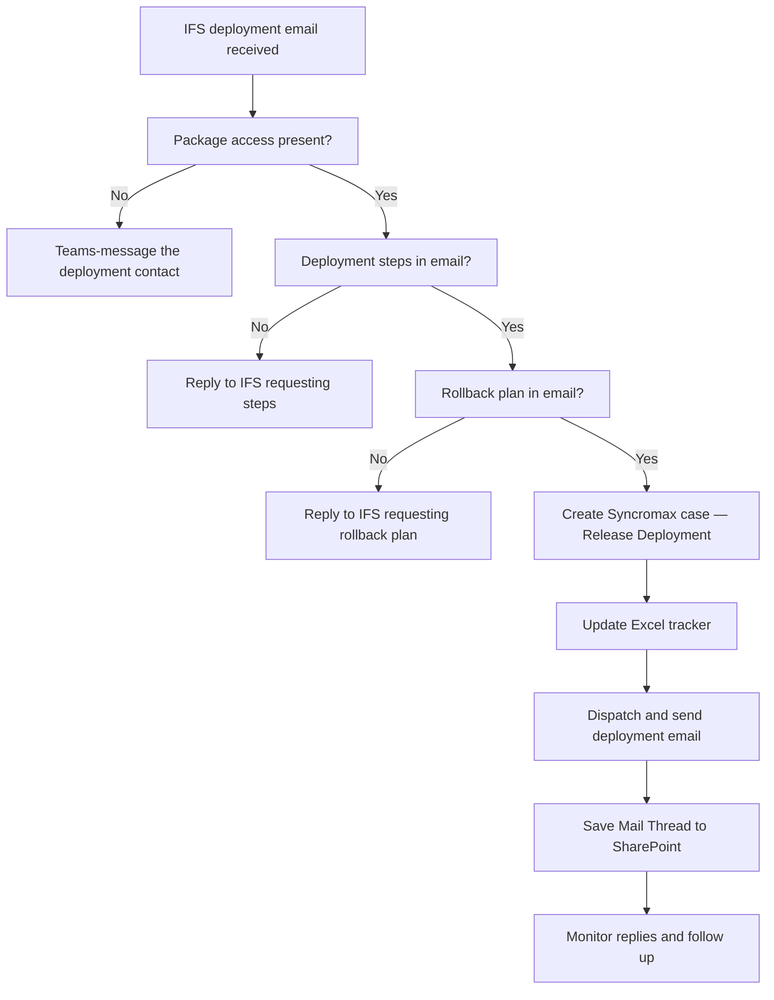

## Purpose

When the [IFS](/docs/glossary#ifs) Support Mail sends a deployment request, L1/L2 creates the Syncromax case, checks that all required information is present, updates the Excel tracker, dispatches to the Technical or MST team, and manages the email thread throughout.

<Callout type="warn" title="To confirm">
What is Syncromax? The notes use it as the case management system, but do not define it or confirm whether it is the same system used across all teams.
</Callout>

<Callout type="warn" title="To confirm">
What is PSO? The notes reference a "PSO Issue number" in the case title format but do not define the abbreviation.
</Callout>

<Callout type="warn" title="To confirm">
What is MST? The notes refer to the "MST team" as one of the teams that carries out deployments, but do not define the abbreviation.
</Callout>

<Callout type="warn">
The Technical and MST team carry out the actual deployment. L1/L2 owns the case, the communications and the tracker — not the deployment steps themselves.
</Callout>

## Before you start

- Have the original IFS email open.
- Have Syncromax and the Excel deployment tracker ready.
- Access SharePoint to save the email thread file.

## Steps

<Steps>
<Step>

### Check the IFS email for all four required items

Before doing anything else, confirm all four of the following are present in the email.

1. **Package access** — the package file is attached, or IFS has included a download link.
2. **Access to the package** — you can actually open or download it.
3. **Deployment steps** — the email lists the steps to carry out.
4. **Rollback plan** — the email includes a rollback procedure.

<Callout type="warn">
  If items 3 or 4 are missing, reply to the IFS email and ask for them **before** creating the case or contacting anyone else. Do not proceed without both.
</Callout>

If item 2 is missing (you cannot access the package), Teams-message the deployment contact before going further.

</Step>
<Step>

### Create the case in Syncromax

Open a new case. The sub-category for deployments is **Release Deployment**.

| Field | Value |
|---|---|
| Title | See format below |
| Category | Service Request |
| Sub Category | **Release Deployment** |
| Product | IFS |
| Priority | 4 – Low (Internal) or 3 – Moderate (Axcenze) |
| Agreement Description | Support |
| Service Agreement ID | 1471 |

**Title format:** `[IFS reference] - [PSO Issue number] - [brief description]`


Example: `CS0555952 - PSO Issue 166 - Package deployment`

</Step>
<Step>

### Update the Excel deployment tracker

Update the tracker **before** dispatching. Fill in all columns for this deployment.


Columns to fill: IFS Case, Item No, Date, Time, Requested By, Requested Deployment Date, Email Subject, Environment, Package Score, Deploy flag, Deployment File, Roll Back, Assigned Person.

</Step>
<Step>

### Dispatch the case and send the deployment email

1. Dispatch the case in Syncromax.
2. Add a contact note: `Assigned on [date]`.
3. Send the deployment email to the assignee, CC-ing everyone from the original IFS email thread:

```
To: [assignee]@[company domain]
CC: [all CCs from the original IFS email]
Subject: P[CaseID] – [IFS ref] – [PSO Issue] – [description]

Dear [Name],

Please deploy the below package in UAT. All the required files and
details are in the SharePoint.

Kindly proceed with the deployment.
```

</Step>
<Step>

### Save the email thread to SharePoint

1. Save the full email thread as a file.
2. Name the file **Mail Thread**.
3. Upload it to the SharePoint folder for this case.

<Callout type="warn" title="To confirm">
Which SharePoint folder does the Mail Thread file go into — is it one folder per case, or a shared deployments folder?
</Callout>

</Step>
<Step>

### Monitor and follow up

When the deployment team replies:

- Read their reply for any outstanding items (e.g. cache refresh pending, server access issues).
- Reply-all to assist or escalate as needed.
- Update the Excel tracker.
- Update the Syncromax case contact note with any new status.

</Step>
</Steps>

## Check it worked

- Syncromax case shows the correct sub-category (Release Deployment) and is dispatched.
- Excel tracker row is complete.
- Mail Thread file is saved to SharePoint.
- Deployment team has confirmed completion with no outstanding blockers.

## Diagnosis



## Related

- [IFS Support: handle a user CRUD request](./ifs-support-user-crud)
