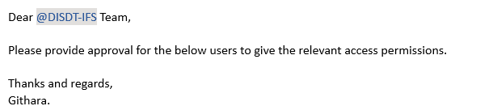
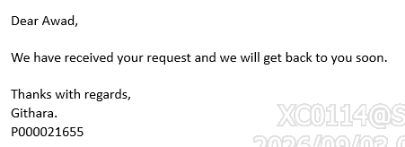
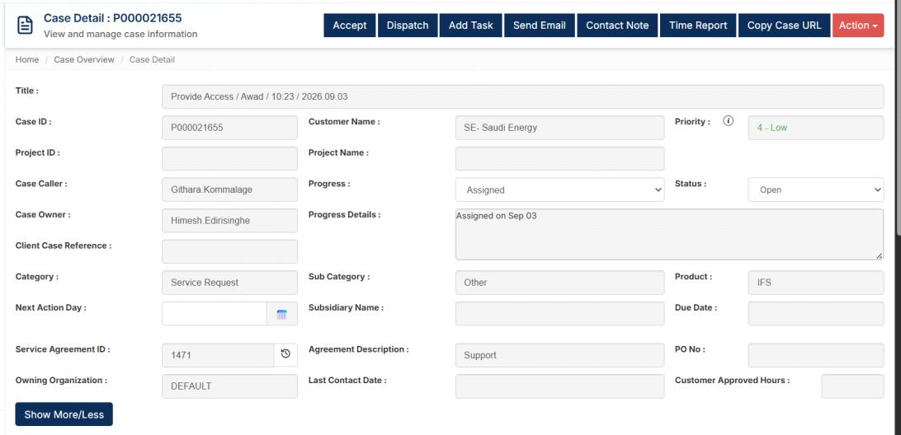
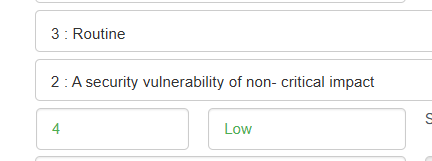
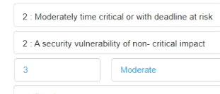

## Purpose

Handle inbound user CRUD requests (create, update, delete) for IFS. Every request needs
DISDT approval unless the sender is already from DISDT, and every request needs a
Syncromax case.

## Before you start

- You need access to the VDI environment at `https://vdi.se.com.sa` for access-related
  requests.
- Have Syncromax open and ready to create a case.
- Document every email you receive — nothing is handled off the record.

## Steps

<Steps>
<Step>

### Check whether DISDT approval is needed

Look at who sent the request.

- **Sender is from DISDT** → no approval email needed, skip to step 2.
- **Sender is not from DISDT** → open a new email addressed to `DISDT-IFS` and send
  the approval request below.



```
To: DISDT-IFS
Subject: [describe the user change, e.g. "Provide Access – Awad Al-Enzi"]

Dear @DISDT-IFS Team,

Please provide approval for the below users to give the relevant
access permissions.

Thanks and regards,
Githara.
```

</Step>
<Step>

### Acknowledge the original requester

While waiting for DISDT approval (or straight away if no approval is needed),
reply-all to the original email. Always address the person by name — use `@` or
type their first name.



```
Dear [Name],

We have received your request and we will get back to you soon.

Thanks with regards,
Githara.
[add the Syncromax case ID here after step 3]
```

</Step>
<Step>

### Create the case in Syncromax

Open a new case and fill in the fields below.



| Field | Value |
|---|---|
| Title | `[Action] / [Requester first name] / [HH:MM] / [YYYY.MM.DD]` |
| Category | Service Request |
| Sub Category | Other |
| Product | IFS |
| Priority | 4 – Low |
| Agreement Description | Support |
| Service Agreement ID | 1471 |
| Owning Organization | DEFAULT |

**Title example:** `Provide Access / Awad / 10:23 / 2026.09.03`

Go back to the acknowledgement email you sent in step 2 and add the case ID at
the end.

</Step>
<Step>

### Dispatch the case

<Tabs items={["Internal", "Axcenze Team"]}>
<Tab value="Internal">

Set **Priority 4 – Low** and dispatch to Internal.



| Code | Meaning |
|---|---|
| 2 | A security vulnerability of non-critical impact |
| 3 | Routine |
| 4 | Low |

</Tab>
<Tab value="Axcenze Team">

Set **Priority 3 – Moderate** and dispatch to the Axcenze Team. The system
assigns it to someone automatically — follow up from the case view.



| Code | Meaning |
|---|---|
| 2 | Moderately time critical or with deadline at risk |
| 2 | A security vulnerability of non-critical impact |
| 3 | Moderate |

</Tab>
</Tabs>

Add a contact note on the case: `Assigned on [date]`.

Update the Excel tracking sheet with the case details.

</Step>
<Step>

### After DISDT approves

1. Reply-all to the email chain — mention the approver by name with `@` or their
   first name.
2. Confirm the case ID is included at the end of the email.

</Step>
</Steps>

## Check it worked

- Syncromax shows the case as **Assigned** with the correct priority and dispatch.
- The original requester has received an acknowledgement with the case ID.
- The Excel tracking sheet is updated.

## Related

- [IFS Support: Production Deployment from IFS](./ifs-support-production-deployment)
