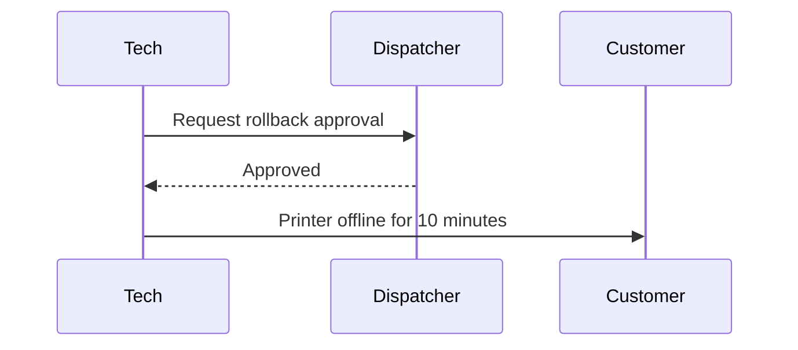

## Purpose

One or two sentences on when and why someone does this.

## Before you start

- Tools, parts, access or permissions needed
- Anything to tell the customer first

## Steps

1. One action per step.
2. Menu paths and buttons exactly as shown.
3. Expected result where it helps.

A sequence diagram when the task is handed between people or systems:

## Check it worked

How to confirm the task succeeded.

## Related

- [Printer shows E42 after a firmware update](../troubleshooting/printer-e42-after-firmware-update)
