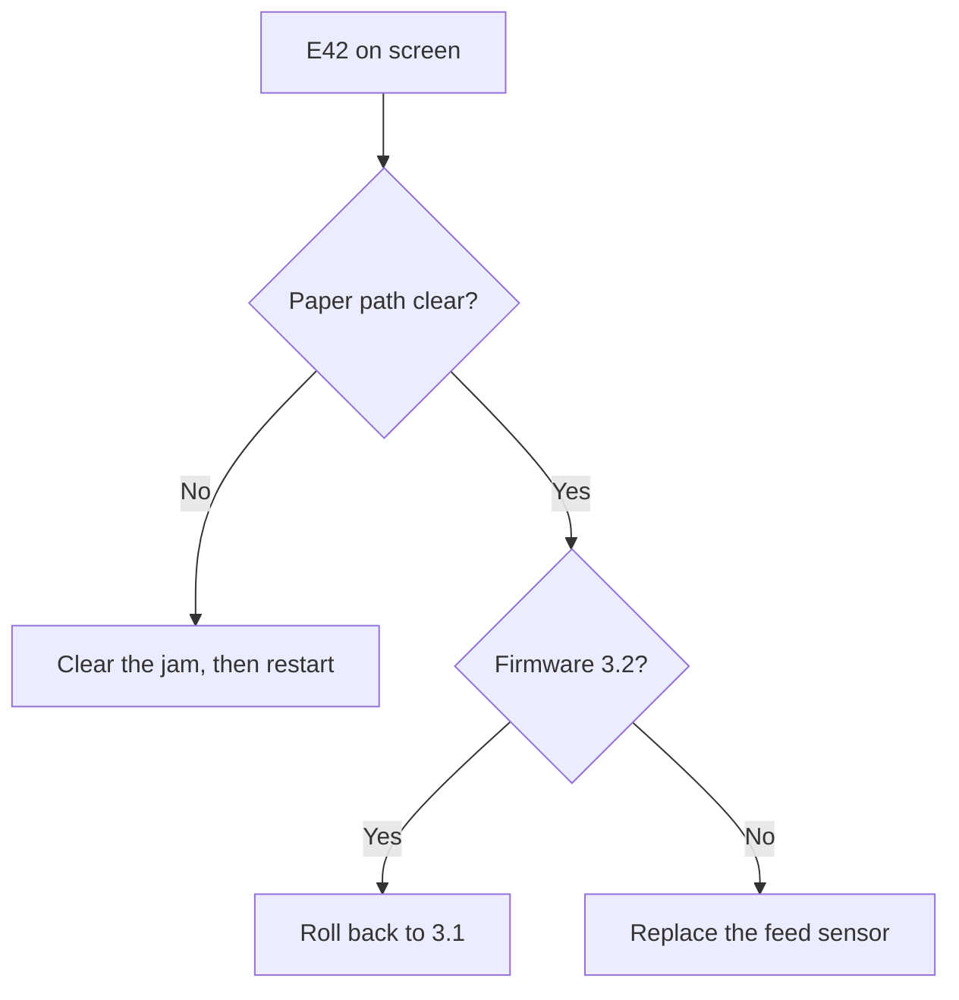

## Symptom

What the tech or customer sees, in their words. Quote error codes and messages exactly, e.g. `E42 Feed sensor fault`.

## Cause

Why it happens, if the notes say. If they do not, say it is unknown.

## Diagnosis

Only when there is more than one branch to check.

## Resolution

1. One action per step.
2. Menu paths and buttons exactly as shown, e.g. **Settings > Service > Sensors**.
3. What the tech should see when it has worked.

<Callout type="warn">
Anything that risks data loss, safety or customer downtime.
</Callout>

## If that does not work

Who to escalate to and what to send them.

## Related

- [Roll back printer firmware](../procedures/roll-back-printer-firmware)
